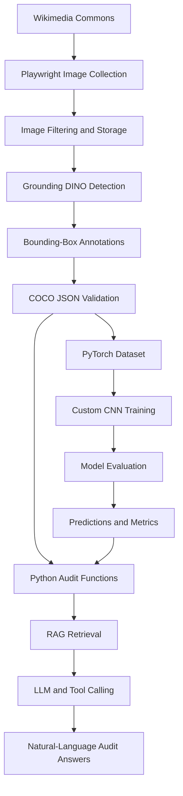
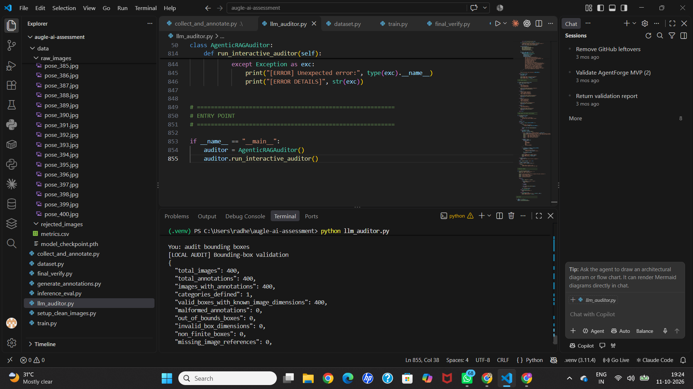
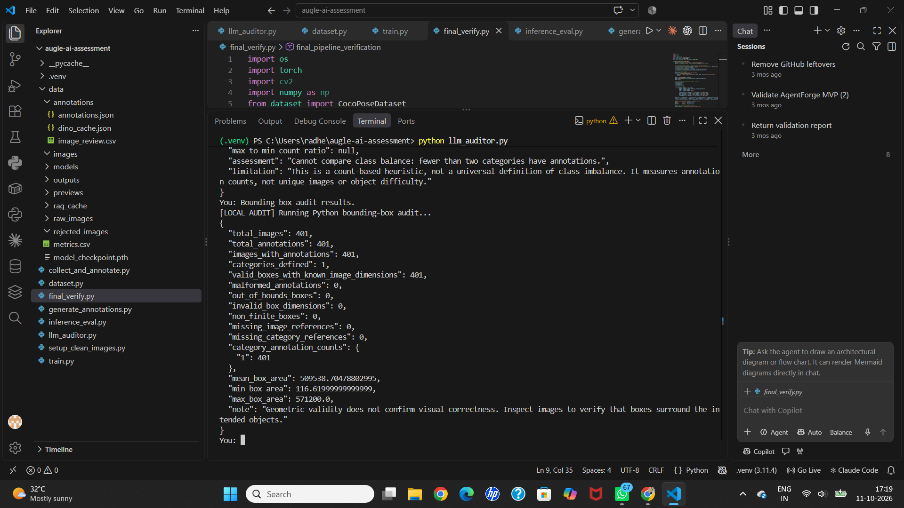

# 🧍 Human Pose Image Pipeline — Data Curation, Deep Learning & AI Auditing

An end-to-end AI/ML engineering project developed for the **Augle AI Internship Assignment**. This project combines browser automation, vision-based annotation, custom deep learning, model evaluation, and LLM-powered dataset auditing in one reproducible pipeline.

The goal is to automate the journey from collecting human images to generating annotations, training a custom CNN, evaluating predictions, and auditing dataset quality with Python tools and a Large Language Model (LLM).

[](https://www.python.org/)
[](https://pytorch.org/)
[](https://opencv.org/)
[](https://playwright.dev/)
[](https://en.wikipedia.org/wiki/Retrieval-augmented_generation)

## 📌 Table of Contents

- [Project Overview](#-project-overview)
- [Pipeline Architecture](#-pipeline-architecture)
- [Project Outputs](#-project-outputs)
- [Technology Stack](#-technology-stack)
- [Project Structure](#-project-structure)
- [How It Works](#-how-it-works)
- [Installation](#-installation-and-setup)
- [Running the Pipeline](#-running-the-pipeline)
- [Validation and Evaluation](#-validation-and-evaluation)
- [Limitations and Future Improvements](#-limitations-and-future-improvements)
- [Key Learnings](#-key-learnings)
- [Author](#-author)

## 🚀 Project Overview

The pipeline consists of three main phases:

| Phase | Objective | Main Technologies |
|---|---|---|
| 📥 Data Collection & Annotation | Collect human images and generate person bounding boxes | Python, Playwright, Grounding DINO |
| 🧠 Model Training & Evaluation | Preprocess images, train a custom CNN, and evaluate predictions | OpenCV, PyTorch, NumPy |
| 🤖 AI-Powered Dataset Auditing | Validate annotations, inspect metrics, and answer questions using retrieved project data | Python, LLM API, RAG, tool calling |

**Core workflow**

`Collect Images → Detect People → Generate Annotations → Validate Dataset → Train CNN → Evaluate Model → Audit Results`

The project demonstrates how multiple AI/ML components can be connected into a single engineering workflow.

## 🔄 Pipeline Architecture



## 📸 Project Outputs

The following screenshots are saved in the repository and embedded directly into this README.

### 1. Dataset Audit Results

This audit report shows the dataset and annotation validation results from an audit run, including checks for malformed annotations and invalid bounding boxes.



### 2. Final Pipeline Verification

This verification report checks image references, annotation structure, bounding-box dimensions, and whether boxes fall outside image boundaries.



> **Note on reported counts:** The saved reports show 400 images and annotations in the first audit and 401 in the final verification. These are outputs from separate runs or stages; rerun both checks against the same final dataset if you need a single consistent count.

## 🛠️ Technology Stack

| Technology | Purpose |
|---|---|
| Python | Main programming language |
| Playwright | Browser automation and image-page collection |
| Grounding DINO | Text-prompt-based person detection |
| OpenCV | Image loading, resizing, and preprocessing |
| PyTorch | Custom CNN architecture and model training |
| COCO JSON | Structured storage for images, categories, and bounding-box annotations |
| NumPy and Pandas | Numerical processing and metrics handling |
| LLM API | Natural-language interpretation of audit questions |
| Retrieval-Augmented Generation (RAG) | Retrieves relevant project information before generating responses |
| Python tool calling | Executes audit functions for data-driven answers |
| Git and GitHub | Version control and project hosting |

## 📁 Project Structure

```text
AI_Assessment/
├── collect_and_annotate.py
├── setup_clean_images.py
├── generate_annotations.py
├── dataset.py
├── train.py
├── inference_eval.py
├── final_verify.py
├── llm_auditor.py
├── requirements.txt
├── README.md
│
└── data/
    ├── raw_images/
    │   └── pose_001.jpg ... pose_400.jpg
    ├── annotations/
    │   ├── annotations.json
    │   └── image_review.csv
    ├── models/
    │   └── custom_pose_cnn.pth
    ├── rag_cache/
    │   └── document_embeddings.npz
    ├── show_result/
    │   ├── Screenshot01.png
    │   └── Screenshot02.png
    ├── metrics.csv
    └── model_checkpoint.pth
```

*The structure above highlights the main files and artifacts. Additional files may exist in your local project.*

## ⚙️ How It Works

### Phase 1 — Image Collection and Automatic Annotation

**1. Collect images**

Playwright automates browser interactions to discover image pages on Wikimedia Commons. Python handles downloading, duplicate filtering, and local file storage.

**2. Detect people**

Grounding DINO uses a text prompt such as `a person` to identify potential people in an image without training a detector specifically for this dataset.

**3. Generate bounding boxes**

Each detection provides a rectangle around the predicted object. A bounding box is represented as:

`[x, y, width, height]`

Here, `x` and `y` specify the top-left corner, while `width` and `height` specify the rectangle's dimensions.

**4. Save and validate annotations**

The annotation pipeline stores image metadata, category information, and bounding-box coordinates in COCO-style JSON. Validation checks help identify malformed annotations, invalid dimensions, missing image references, and boxes outside image boundaries.

**Output:** Collected images and structured annotations for training and auditing.

### Phase 2 — Custom CNN Training and Evaluation

**1. Image preprocessing**

The custom PyTorch Dataset loads images and corresponding annotations. OpenCV is used to resize images to `640 × 640`, convert BGR to RGB, and normalize pixel values.

Bounding-box coordinates must be transformed using the same resizing factors as the images.

**2. Build a CNN from scratch**

The custom model, `MultiTaskCustomPoseCNN`, uses convolutional layers to learn visual features.

Its main components include:

- **Convolution layers:** Learn visual patterns and spatial features.
- **Batch normalization:** Helps stabilize training.
- **ReLU activation:** Introduces non-linearity.
- **Max pooling:** Reduces spatial dimensions.
- **Adaptive average pooling:** Produces a fixed-size feature representation.
- **Fully connected layers:** Generate final predictions.
- **Dropout:** Helps reduce overfitting.

The model has two output heads:

- **Classification head:** Predicts the target class.
- **Bounding-box head:** Predicts the object's location.

The model is trained from scratch rather than using a pretrained CNN backbone, in line with the assignment's custom-model requirement.

**3. Train the network**

The training loop follows:

`Forward Pass → Loss Calculation → Backpropagation → Optimizer Update`

The implementation uses Adam for optimization, Cross-Entropy Loss for classification, and Smooth L1 Loss for bounding-box regression. A learning-rate scheduler adjusts the learning rate during training.

Training metrics are saved in `data/metrics.csv`, and model weights are saved in checkpoint files.

**4. Evaluate predictions**

The evaluation script reports classification accuracy and normalized bounding-box Mean Absolute Error (MAE). It also generates prediction outputs for visual inspection.

Lower coordinate MAE generally indicates smaller coordinate errors, but it does not replace object-detection metrics such as Intersection over Union (IoU).

**Output:** A trained CNN, saved checkpoints, training metrics, and evaluation artifacts.

### Phase 3 — LLM-Based Dataset Auditor

The auditing component helps inspect the dataset and training results through natural-language questions.

Example questions include:

- How many annotations are available?
- Are any bounding boxes invalid?
- Are there image references missing from the annotation file?
- What happened to the training or validation loss?
- Which data-quality checks failed?

**1. Data ingestion**

The auditor reads the annotation JSON and training metrics CSV.

**2. Python audit functions**

Python functions perform calculations such as annotation counting, category summaries, bounding-box checks, and metric retrieval.

**3. Retrieval-Augmented Generation (RAG)**

RAG retrieves relevant information from the project's data before the LLM generates an answer. This helps ground responses in actual audit results rather than relying only on the model's general knowledge.

**4. Tool calling**

When a question requires a calculation, the LLM can request an appropriate Python function. The function performs the calculation, and the LLM can explain the result in natural language.

Local audit functions can run independently of the LLM. Natural-language responses require the configured API provider to be available.

**Output:** An AI-assisted interface for understanding dataset quality and training results.

## 💻 Installation and Setup

### Prerequisites

- Python installed on your system
- Git
- VS Code or another Python-compatible editor
- Internet access for image collection and model downloads
- An API key for the chosen LLM provider, if running the LLM features

### 1. Clone the repository

```bash
git clone https://github.com/RadheyaGaikwad/AI_Assessment.git
cd AI_Assessment
```

### 2. Create a virtual environment

**Windows PowerShell**

```powershell
python -m venv .venv
.\.venv\Scripts\Activate.ps1
```

If PowerShell blocks activation, use the appropriate virtual-environment activation method for your system.

### 3. Install dependencies

```bash
python -m pip install -r requirements.txt
playwright install chromium
```

For PyTorch and other packages, follow the compatibility requirements of your Python version and hardware.

### 4. Configure the LLM API

Set the API key using the environment-variable name expected by your selected provider and by `llm_auditor.py`.

Never commit API keys, passwords, or `.env` files containing secrets to GitHub.

## ▶️ Running the Pipeline

Run commands from the project root. The following is the intended workflow; check each script's implementation and arguments before running it.

```bash
python collect_and_annotate.py
python generate_annotations.py
python final_verify.py
python train.py
python inference_eval.py
python llm_auditor.py
```

**Important:** If image collection already creates annotations, check whether `generate_annotations.py` expects an intermediate detection cache such as `dino_cache.json`. Likewise, the auditor may need its own API configuration. Use the existing data files and script requirements rather than rerunning expensive stages unnecessarily.

## 📊 Validation and Evaluation

The project includes checks for data quality and model behavior.

| Validation or metric | What it checks |
|---|---|
| Image validation | Whether images can be opened and processed |
| Annotation validation | Whether annotation records have valid structure |
| Bounding-box validation | Whether boxes have valid dimensions and coordinates |
| Image-reference validation | Whether annotations refer to existing images |
| Training and validation loss | How prediction error changes during training |
| Classification accuracy | The fraction of correctly classified examples |
| Bounding-box MAE | Average absolute error in predicted box coordinates |
| Visual prediction review | Whether model predictions appear reasonable in example images |

The saved screenshots demonstrate the validation reports produced by the project. Numerical model performance should be reported from the actual evaluation outputs rather than inferred from dataset validation alone.

## ⚠️ Limitations and Future Improvements

- **Annotation quality:** Review automatically generated boxes to identify false positives and missed detections.
- **Detection evaluation:** Add IoU and other suitable detection metrics.
- **Multiple people:** Extend the model to predict multiple objects in an image.
- **Pose estimation:** Add keypoint annotations and a suitable keypoint model if the goal is full skeletal human-pose estimation.
- **Data augmentation:** Apply transformations while updating bounding-box coordinates correctly.
- **Training improvements:** Tune hyperparameters, use early stopping, and compare model configurations.
- **Reproducibility:** Pin dependencies, document model versions, and record random seeds.
- **Dataset consistency:** Ensure audit reports use the same final dataset and produce consistent counts.
- **RAG evaluation:** Test retrieved evidence and generated answers against known audit results.

**Scope clarification:** The current custom CNN predicts a class and bounding box. It is a person-localization pipeline, not a full skeletal keypoint pose-estimation system.

## 📚 Key Learnings

Through this project, I gained practical experience in:

- Browser automation and image collection.
- Text-prompt-based object detection.
- COCO-style annotation generation and validation.
- Image preprocessing and bounding-box geometry.
- Custom CNN development in PyTorch.
- Loss calculation, backpropagation, and optimization.
- Model evaluation and metrics interpretation.
- Building Python-based dataset audit functions.
- Connecting LLMs with project data using RAG and tool calling.
- Organizing a multi-stage AI/ML engineering pipeline.

## 👨‍💻 Author

**Radheya Gaikwad**

B.E. Artificial Intelligence and Data Science

- **GitHub:** [RadheyaGaikwad](https://github.com/RadheyaGaikwad)
- **LinkedIn:** [Radheya Gaikwad](https://linkedin.com/in/radhegaikwad/)

---

⭐ Built for the **Augle AI Internship Assignment — AI/ML Engineering Track**.
