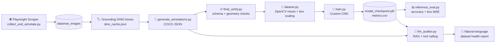

# 🧍 Human Pose Data Pipeline: Scrape → Auto-Label → Train → Audit

An end-to-end AI pipeline built for the **Augle AI – AI Intern Assignment**.
It collects human-pose images with **Playwright**, builds **COCO JSON** annotations from **Grounding DINO** predictions, trains a **custom CNN from scratch in PyTorch**, and audits the dataset with an **LLM-based auditor** (RAG + tool calling).

---

## 📌 Table of Contents

1. [Pipeline Overview](#-pipeline-overview)
2. [Project Structure](#-project-structure)
3. [Setup & Run](#-setup--run)
4. [What Each Phase Does](#-what-each-phase-does)
5. [Model Architecture & Why](#-model-architecture--why)
6. [Mapping to Evaluation Criteria](#-mapping-to-evaluation-criteria)
7. [Demo Run & Sample Outputs](#-demo-run--sample-outputs)
8. [What I Learned](#-what-i-learned)
9. [Known Limitations & Next Steps](#-known-limitations--next-steps)

---

## 🔄 Pipeline Overview



**Flow in one line:** raw web images → zero-shot boxes → validated COCO file → PyTorch dataset → trained model → LLM audits both the annotations and the training metrics.

---

## 📁 Project Structure

```
augle-ai-assessment/
├── collect_and_annotate.py   # Phase 1: Playwright scraper
├── setup_clean_images.py     # Fallback: download a fixed image pool by URL
├── generate_annotations.py   # Phase 1: builds COCO JSON from Grounding DINO cache
├── dataset.py                # Phase 2: PyTorch Dataset + OpenCV preprocessing
├── train.py                  # Phase 2: CNN, training loop, LR scheduler
├── inference_eval.py         # Phase 2: validation metrics + prediction image
├── final_verify.py           # Full dataset + schema verification
├── llm_auditor.py            # Phase 3: Agentic RAG auditor
├── requirements.txt          # Pinned dependencies
└── data/
    ├── raw_images/           # 400 images (pose_001.jpg ...)
    ├── rejected_images/      # Images filtered out
    ├── annotations/          # annotations.json, dino_cache.json
    ├── outputs/              # sample_prediction.jpg
    ├── metrics.csv           # Per-epoch training log
    └── model_checkpoint.pth  # Best model weights
```

---

## ⚙️ Setup & Run

**Requirements:** Python 3.11, Git

```bash
# 1. Clone and enter the project
git clone https://github.com/<your-username>/augle-ai-assessment.git
cd augle-ai-assessment

# 2. Create a virtual environment
python -m venv .venv
.venv\Scripts\activate          # Windows
# source .venv/bin/activate     # Linux / macOS

# 3. Install dependencies
pip install -r requirements.txt
playwright install chromium

# 4. (Phase 3 only) set your LLM API key
set LLM_API_KEY=your_key_here   # Windows
# export LLM_API_KEY=your_key_here
```

**Run the pipeline in order:**

| Step | Command | Output |
|------|---------|--------|
| 1. Collect images | `python collect_and_annotate.py` | `data/raw_images/` |
| 2. Build COCO JSON | `python generate_annotations.py` | `data/annotations/annotations.json` |
| 3. Verify dataset | `python final_verify.py` | Console report (PASS / WARNING) |
| 4. Train model | `python train.py` | `metrics.csv`, `model_checkpoint.pth` |
| 5. Evaluate | `python inference_eval.py` | Accuracy, box MAE, `sample_prediction.jpg` |
| 6. Audit with LLM | `python llm_auditor.py` | Interactive Q&A in terminal |

Reproducibility: all runs use `SEED = 42` (Python, NumPy, PyTorch, cuDNN deterministic) and a fixed 80/20 train/val split shared by `train.py` and `inference_eval.py`.

---

## 🧩 What Each Phase Does

### Phase 1: Automated Collection & Annotation

| Task | Implementation |
|------|----------------|
| Browser automation | Headless Chromium via **Playwright** visits 4 Wikimedia Commons categories (Standing, Sitting, Kneeling, Human postures) |
| Scrolling & extraction | `page.evaluate()` runs JavaScript in the page to collect image URLs from gallery elements, scrolling to load more |
| High-resolution images | Thumbnail URLs (`/thumb/...`) are rewritten to the original full-size file URL |
| Cleaning | Removes SVGs, strips query strings, de-duplicates URLs with a `set` |
| Safe downloading | Never overwrites existing files; continues numbering; falls back to `page.request.get()` if `requests` fails |
| Auto-labeling | `generate_annotations.py` reads **Grounding DINO** predictions from `dino_cache.json` |
| COCO output | `images`, `categories` (`person`), `annotations` (`bbox` as `[x, y, w, h]`, `area`, `iscrowd`) |
| Validation | Corrupt images are removed; boxes are clamped inside image bounds; minimum box size enforced |

### Phase 2: Custom PyTorch Training

| Task | Implementation |
|------|----------------|
| Dataset | `COCOHumanPoseDataset` parses COCO JSON from scratch and returns `(image_tensor, target)` |
| Preprocessing | OpenCV BGR→RGB, resize to 640×640, scale to `[0, 1]` |
| Box geometry | Boxes are clipped in original space, then scaled with the **same independent x/y factors** as the image |
| Safety checks | Duplicate IDs, unknown categories, NaN/Inf, zero-size boxes, and image size mismatch against JSON metadata |
| Training loop | Manual loop: `zero_grad → forward → loss → backward → step` |
| Loss | `CrossEntropy` (class) + `5.0 × SmoothL1` (box) |
| Scheduler | `StepLR` (γ = 0.1) with Adam + weight decay |
| Logging | `metrics.csv` per epoch (train/val total, class and box loss, learning rate) |
| Checkpointing | Saves the best model by validation loss |

### Phase 3: Agentic RAG Data Auditor (`llm_auditor.py`)

| Task | Implementation |
|------|----------------|
| Ingestion | Reads the COCO annotation file and training metrics log |
| Query interface | Interactive terminal: ask about dataset health in plain English |
| Tool calling | Local Python audit tools compute bounding-box validity, areas and class counts directly from the JSON |
| Local audit | Works offline, so numbers come from code, not from the LLM guessing |

> **Note on the demo:** the LLM API's **daily free quota ran out**, so the live auditor demo is limited to **20 questions**. The local audit tools do not use the API and always work.

---

## 🧠 Model Architecture & Why

`MultiTaskCustomPoseCNN` is a small CNN built from scratch (no ResNet or pretrained backbone).

```
Input 3×640×640
 → [Conv3×3(16) → BN → ReLU → MaxPool]
 → [Conv3×3(32) → BN → ReLU → MaxPool]
 → [Conv3×3(64) → BN → ReLU → AdaptiveAvgPool(4×4)]
 → Flatten (1024) → Linear(256) → ReLU → Dropout(0.3)
        ├── Classifier head: Linear(256 → num_classes)
        └── Box head: Linear(256→64) → ReLU → Linear(64→4) → Sigmoid
```

| Decision | Reason |
|----------|--------|
| **3 conv blocks** | Dataset is small (400 images); a shallow net trains fast and overfits less |
| **3×3 kernels, padding=1** | Standard small receptive field, keeps spatial size, few parameters |
| **BatchNorm** | Stable gradients and faster convergence with small batches |
| **Adaptive average pooling (4×4)** | Fixed-size feature map, independent of input resolution, far fewer FC weights |
| **Shared FC + two heads** | Multi-task learning: one shared representation for class and box |
| **Sigmoid on box head** | Outputs normalized `cx, cy, w, h` in `[0, 1]`, matching the targets |
| **Dropout 0.3 + weight decay** | Regularization for a small dataset |
| **No skip connections** | Network is only 3 conv layers deep, so vanishing gradients are not a problem. Skips become useful if depth increases |

---

## 🎯 Mapping to Evaluation Criteria

### 1. Data Engineering & Geometry (25%)

| Requirement | Status | Where |
|-------------|--------|-------|
| ≥150 images with Playwright | ✅ 400 images | `collect_and_annotate.py` |
| Complex category | ✅ Human poses | Wikimedia categories |
| Strict COCO JSON | ✅ | `generate_annotations.py` |
| Schema validation before Phase 2 | ✅ | `final_verify.py` (all 400 samples checked) |
| Resize + box adjustment | ✅ Independent x/y scaling, clip-then-scale | `dataset.py` |
| Normalization | ✅ `[0, 1]` | `dataset.py` |
| Affine augmentations | ⚠️ Not yet implemented (see roadmap) | – |

### 2. Deep Learning Architecture (30%)

| Requirement | Status | Where |
|-------------|--------|-------|
| Custom Dataset / DataLoader | ✅ with custom `collate_fn` for variable-length targets | `dataset.py` |
| Custom CNN, no pretrained backbone | ✅ | `train.py` |
| Architecture justification | ✅ | Section above |
| Manual training loop | ✅ | `train.py` |
| Gradient management | ✅ `zero_grad(set_to_none=True)`, `backward`, `step`, finite-loss check | `train.py` |
| Device placement | ✅ CUDA/CPU auto-select, tensors moved each batch | `train.py`, `inference_eval.py` |
| LR scheduler | ✅ StepLR | `train.py` |
| Custom/combined loss | ✅ Weighted classification + box loss | `train.py` |
| Early stopping | ⚠️ Best-checkpoint saving only; patience-based stop not added | – |
| W&B / TensorBoard | ⚠️ CSV logging only for now | `metrics.csv` |

### 3. LLM & Agentic Logic (25%)

| Requirement | Status | Where |
|-------------|--------|-------|
| Ingest COCO JSON + metrics | ✅ | `llm_auditor.py` |
| Natural-language query interface | ✅ Interactive terminal | `llm_auditor.py` |
| Custom Python tools on JSON | ✅ Bounding-box validation, area and class statistics | `llm_auditor.py` |
| ≥2 tool-call scenarios | ✅ See demo below | `llm_auditor.py` |

### 4. Software Engineering (20%)

| Requirement | Status | Notes |
|-------------|--------|-------|
| Decoupled functions | ✅ | Each phase is its own file with single-purpose functions |
| PEP-8 | ✅ | Docstrings, clear names, line-length managed |
| Reproducibility | ✅ | Fixed seed, deterministic cuDNN, fixed split, saved config in checkpoint |
| Error handling | ✅ | Clear exceptions for missing files, bad boxes, NaN loss |
| Pinned requirements | ⚠️ Run `pip freeze > requirements.txt` to lock exact versions | – |

---

## 🖼️ Demo Run & Sample Outputs

### A. Dataset audit (tool call: bounding-box validation)

```
You: audit bounding boxes
[LOCAL AUDIT] Bounding-box validation
{
  "total_images": 400,
  "total_annotations": 400,
  "images_with_annotations": 400,
  "categories_defined": 1,
  "valid_boxes_with_known_image_dimensions": 400,
  "malformed_annotations": 0,
  "out_of_bounds_boxes": 0,
  "invalid_box_dimensions": 0,
  "non_finite_boxes": 0,
  "missing_image_references": 0
}
```

### B. Model prediction on a validation image

`inference_eval.py` draws the predicted box (green) on a validation sample and saves it to `data/outputs/sample_prediction.jpg`.

<!-- Add the screenshot: copy sample_prediction.jpg to docs/ and uncomment -->
<!--  -->

### C. Training and evaluation logs

```
Epoch 1/5 | train=...  | val=...  | cls=...  | box=...
...
[RESULT] Classification accuracy: ...%
[RESULT] Normalized bounding-box coordinate MAE: ...
```

> Paste your real numbers from `data/metrics.csv` and the `inference_eval.py` console here.

### D. More auditor queries (20-question limit)

| # | Example question | Tool used |
|---|------------------|-----------|
| 1 | "Audit bounding boxes" | Bounding-box validation |
| 2 | "Is the dataset class balanced?" | Class distribution |
| 3 | "Are there suspiciously small boxes?" | Area analysis |
| 4 | "How did validation loss change per epoch?" | Metrics retrieval |

---

## 📚 What I Learned

- **Playwright:** launching headless Chromium, setting a real user-agent, waiting for `domcontentloaded`, scrolling with `page.mouse.wheel`, running JavaScript inside the page with `page.evaluate`, and using `page.request.get` as a download fallback.
- **Data cleaning at scrape time:** converting thumbnail URLs to full-resolution URLs, filtering SVGs, removing duplicate URLs, and never overwriting existing data.
- **COCO format:** `[x, y, w, h]` boxes, `images / annotations / categories`, and mapping arbitrary category IDs to contiguous labels.
- **Geometry correctness:** when you resize an image with different x and y factors, boxes must be scaled with the same two factors, and clipped *before* scaling.
- **Zero-shot labeling:** using a foundation model (Grounding DINO) to label data without manual work, and why those labels still need validation.
- **PyTorch from scratch:** custom `Dataset`, `collate_fn` for variable-length targets, multi-task heads, combined loss, scheduler, deterministic seeds, and reproducible splits.
- **Honest evaluation:** box MAE is not IoU or mAP, so it cannot alone prove detection quality.
- **LLM tool calling:** letting the LLM call Python functions so numeric answers are computed by code instead of guessed.
- **Practical limits:** handling API daily quotas by keeping a local, offline audit path.

---

## ⚠️ Known Limitations & Next Steps

| Limitation | Planned fix |
|------------|-------------|
| Single-box target: model predicts only the largest person per image | Move to multi-object detection (e.g., anchor-based head) |
| No OpenCV affine augmentation yet | Add rotation/scale/translation with matching box transform in `dataset.py` |
| No TensorBoard / W&B | Add `SummaryWriter` for loss curves and augmented sample images |
| No patience-based early stopping | Stop when validation loss does not improve for N epochs |
| Only one class (`person`), so classification is trivial | Use pose categories (standing/sitting/kneeling) as classes |
| Images without a DINO box get a fallback center region | Re-run Grounding DINO on all images and drop those with no detection |
| Training is short (5 epochs) | Train longer, report IoU / mAP |
| LLM demo limited by daily API quota | Use a local model or higher quota |

---

## 👤 Author

**Your Name**: AI Intern Assessment Submission, Augle AI
GitHub: `https://github.com/<your-username>`
